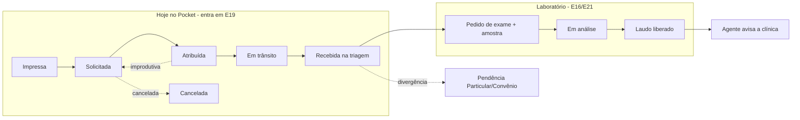

# CRM, Coletas e Relacionamento (substituição do Pocket) — Integração ao Alchemypet Integrado

> Status: **Mapeamento de integração** — sem implementação nesta etapa.
> Fonte: SPEC *"Nova Plataforma de Logística e Relacionamento Alchemypet"* (02/11/2026,
> levantamento do **Sistema Pocket** tela a tela) cruzada com o que já existe neste repositório
> ([Gestão de Clínica](GESTAO-CLINICA-MAPEAMENTO.md), [Escopo geral](ESCOPO-ORCAMENTO.md) e o
> backend M1 em produção).
> Data: 2026-11-02

---

## 1. Resumo

A SPEC descreve a troca do **Sistema Pocket** (ERP em PHP que hoje roda a logística de coleta,
o CRM comercial e o agente de WhatsApp) por uma plataforma própria. **Tudo o que ela pede já tem
lugar no Alchemypet Integrado**: são os épicos E18 (CRM), E19 (Rastreio & Logística) e E20
(Agente de atendimento), mais um pedaço de E14 (Faturamento) e de E1 (perfis).

Recomendação: **não criar um sistema separado**. A SPEC entra como módulo do Integrado,
na mesma API, banco, login e deploy, com três ajustes:

1. **Stack do Integrado** (FastAPI + SQLAlchemy + Next.js + PostgreSQL), não a proposta da SPEC
   (Turborepo + NestJS + Prisma). Detalhe em §5.
2. **Uma conta de clínica só**: a `Account` da SPEC passa a ser a clínica do Integrado, a mesma
   que já aparece nas pendências de convênio/particular e nos chamados. Detalhe em §4.
3. **A OS do Pocket vira a primeira metade da cadeia de custódia da amostra**: o Pocket termina
   em "Recebida na triagem"; o Integrado continua até o laudo liberado (E16). Detalhe em §3.

O que muda no orçamento: E18 e E19 ficam mais detalhados e maiores, entra a migração do Pocket
(novo E22) e o Coletas deixa de ser "onda 4" e passa a ser candidato a **subir para o começo do
contrato**, porque substitui um sistema usado todo dia. Ver §7 e §8 — **são decisões em aberto**.

---

## 2. Onde cada parte da SPEC entra

| Módulo da SPEC | Épico no Integrado | Situação antes | O que a SPEC acrescenta |
|---|---|---|---|
| 1. Coletas (etiquetas, solicitação, despacho, retirada, improdutiva, transferência, recebimento, cancelamento) | **E19 Rastreio & Logística** | Descrito em alto nível (§3.13 do mapeamento) | Regras concretas do ciclo da OS, ZPL/PDF, despacho por região com aceite, transferência com aprovação, improdutiva com urgência, recebimento em lote com divergências |
| 2. Torre de controle (quadro região × status, alertas de SLA, modo TV) | **E19** (painel de logística) | "Painel de logística" genérico | Tempo real (≤ 5 s), alertas de confirmação/retirada em atraso, modo TV com filas de emergência e gasometria |
| 3. CRM (conta única, kanban, qualificação, atividades, importação, saúde da carteira) | **E18 CRM** | Funil prospecção → ativa → inativa | Funil real do Pocket (Lead → Distribuição → Contratos → Onboarding → Cliente Ativo; Inativo/Bloqueado), campos de qualificação, 9 tipos de atividade + ranking, importação com dedup, alerta de clínica sem OS |
| 4. Relacionamento e IA (réguas, agente WhatsApp, contatos autorizados, prompts) | **E20 Agente** + **E8 Lembretes** | Agente sobre Chatwoot; "já existe um agente" | O agente existente **é o módulo IA do Pocket** (Prompts, Base de Conhecimento vazia, Conexão WhatsApp IA, Membros IA). Novas ferramentas: solicitar retirada, status de OS, 2ª via de etiqueta. Régua dia 1/3/6 |
| 5. Financeiro (tabela região × turno com vigência, taxas de emergência no mês) | **E14 Faturamento** (+ E11) | Lote de faturas por clínica/convênio | Regra de preço com vigência e cálculo automático da taxa de emergência para a fatura mensal da clínica |
| 6. Administração (papéis, escopos, transportadoras, auditoria, sessões, canais) | **E1 Fundação** | Perfis atendente/supervisor/admin | 7 perfis com escopo (ver §4.3), transportadoras terceirizadas, sessões ativas |
| Migração do Pocket | **Novo E22** | — | Extração, unificação clínica + lead, histórico de 12 meses, piloto por região, corte com Pocket só leitura por 90 dias |

### 2.1 O que o Integrado já tem e o Coletas/CRM reaproveita

| Já existe (em produção) | Uso no novo módulo |
|---|---|
| Login JWT, perfis, tela de usuários (`backend/app/security.py`, `routers/usuarios.py`) | Base dos 7 perfis; só se acrescentam perfis e escopo |
| Tabela `clinica` (código, nome, atende convênio) | Vira a `Account` do CRM (§4.1) |
| Pendências Particular/Convênio + tratativas | Divergência no recebimento da triagem pode abrir pendência; pendências aparecem na linha do tempo da conta |
| Chamados por e-mail (classificação por motivo/complexidade) | Entram na linha do tempo da conta pelo e-mail do contato |
| Importação idempotente de planilhas (`importer.py`, chave natural) | Mesmo padrão para importar leads e para a migração do Pocket |
| Exportação XLSX/PDF, filtros por período, dashboard com KPIs | Relatório gerencial de coletas e ranking de atividades |
| Deploy no Coolify com Postgres (`pgvector`) | Mesmo deploy; o `pgvector` já serve à base de conhecimento do agente |

---

## 3. Ciclo da amostra ponta a ponta

O Pocket cuida do transporte; o Integrado cuida do laboratório. Juntando os dois, a etiqueta da
OS passa a ser o identificador da remessa desde a clínica até o laudo:

Regras de encaixe:

- A **OS** (`Label`) fica com o número sequencial e o QR do Pocket. No recebimento, a triagem
  liga cada OS ao **pedido de exame** e às **amostras** de E16 (uma OS pode trazer várias
  amostras/guias).
- A **linha do tempo única** mostra os eventos da OS (append-only, como na SPEC) seguidos dos
  eventos do laboratório. A clínica e o agente consultam um status só.
- **Divergência** no recebimento (OS esperada que não chegou, OS não solicitada que chegou,
  amostra sem guia) pode abrir pendência no módulo Particular/Convênio já existente, com
  tratativa.
- **Emergência** (3h30 da retirada ao resultado) vira prioridade no mapa de trabalho do LIS, não
  só na fila do portador.

---

## 4. Modelo de dados integrado

### 4.1 Clínica = Account

A tabela `clinica` atual é evoluída (não duplicada) para a `Account` da SPEC:

| Hoje (`clinica`) | Acrescenta (SPEC) |
|---|---|
| `id`, `codigo`, `nome`, `atende_convenio` | `codigo_legado` (Pocket), `nome_empresa`, `cpf`, `cnpj`, `segmento`, `etapa_funil`, `motivo_encerramento`, `temperatura`, `captacao`, `decisor`, `atendimentos_mes`, `exames_mes`, `divide_laboratorio`, `nota_laboratorio`, `convenios`, `possui_camera`, `horarios`, `observacoes`, `regiao_id`, `vendedor_id` |

- O **código da clínica** é a chave que liga tudo: `pendencia.cod_clinica` (planilhas atuais),
  código do Pocket e código do software de gestão. A migração precisa confirmar que é o mesmo
  código nos três (pendência P-I3).
- **Tutores (B2C)** continuam em E2 (Clientes & Pacientes). O CRM da SPEC é só B2B; o CRM do
  Integrado mostra os dois, mas o funil comercial é das clínicas.

### 4.2 Entidades novas

`Address`, `Contact` (com `autorizado_ia`), `Region`, `CourierCompany`, `Courier`, `Label` (OS),
`LabelEvent` (append-only), `PickupRequest`, `Transfer`, `UnproductiveVisit`, `PriceRule`
(região × turno × vigência), `Activity`, `Competitor`, `MessageCadence`, `AgentConfig`,
`KnowledgeDoc`, `AuditLog` — como na SPEC, escritas em SQLAlchemy no padrão de `models.py`
(UUID em string, enums validados no Pydantic).

Ligações com o resto do Integrado:

| Entidade da SPEC | Liga em |
|---|---|
| `Label` | `PedidoExame` / `Amostra` (E16) no recebimento |
| `PriceRule` + `PickupRequest(tipo=emergencia)` | Itens da fatura mensal da clínica (E14) |
| `Activity` | Mesma linha do tempo de tratativas, chamados e conversas do Chatwoot |
| `Contact.autorizado_ia` | Contato do Chatwoot (E20) — quem o agente pode atender por clínica |
| `AuditLog` | Substitui as auditorias pontuais; `tratativa.por_agente` continua valendo |

### 4.3 Perfis

`usuario.perfil` hoje aceita `atendente | supervisor | admin`. Entram `supervisor_logistica`,
`triagem`, `comercial`, `clinica`, `portador` e `transportadora`, com **escopo**: vendedor vê a
própria carteira, portador vê a própria região ou coletas atribuídas, clínica vê as próprias OS,
transportadora vê os próprios portadores. Clínica e portador usam PWA, não o backoffice.

---

## 5. Stack: SPEC × Integrado

| Camada | SPEC propõe | Integrado usa | Recomendação |
|---|---|---|---|
| API | NestJS + Prisma | FastAPI + SQLAlchemy | **FastAPI** — um backend, um login, sem segunda linguagem no servidor (premissa §8.1 do mapeamento) |
| Front | Next.js + PWAs, Turborepo | Next.js | **Next.js** no mesmo `frontend/`; PWAs da clínica, portador e triagem como rotas instaláveis (manifest + service worker). Monorepo Turborepo só se os PWAs crescerem a ponto de pedir build separado |
| Banco | PostgreSQL | PostgreSQL (`pgvector`) | Igual |
| Migrações de schema | Prisma Migrate | `create_all` + `ALTER ... IF NOT EXISTS` na subida (`main.py`) | **Adotar Alembic** antes de começar: o módulo cria ~17 tabelas e o padrão atual não escala |
| Tempo real | Socket.IO | — | WebSocket nativo do FastAPI (ou SSE) para torre e modo TV |
| Filas e timers | Redis + BullMQ | — | Redis + worker Python (arq ou RQ) para SLA, notificações e réguas |
| WhatsApp | Evolution API ou Z-API | WhatsApp **oficial** via Chatwoot | **Decisão em aberto (P-I2)**. Evolution/Z-API são não oficiais (risco de bloqueio do número); a premissa do Integrado é a API oficial |
| IA | Claude com tool use | Claude, agente como bot do Chatwoot | Igual; as ferramentas chamam a API do Integrado |
| Impressão | ZPL + PDF | PDF (reportlab/weasyprint) | Acrescenta geração ZPL |
| Deploy | Docker no Coolify/Easypanel | Docker no Coolify | Igual |
| Observabilidade | Logs estruturados + Sentry | — | Acrescentar Sentry (front e PWA do portador) |

Regra da SPEC mantida: **nenhuma regra de negócio no gateway de WhatsApp, no Chatwoot ou em
N8N**. Toda mudança de status passa pela API, que publica o evento para a torre e as filas.

---

## 6. Agente de WhatsApp: juntar SPEC e E20

| Tema | SPEC | E20 (Integrado) | Como fica |
|---|---|---|---|
| Caixa de entrada | Não prevê | Chatwoot omnichannel | Chatwoot; o agente é o bot dele |
| Ferramentas | Solicitar retirada, status de OS, 2ª via de etiqueta, dúvidas de exames | Status de exame e laudo, agenda, lembretes, chamado, pendência de convênio, suprimentos | **Soma das duas listas**; status da OS e do exame viram uma consulta só (§3) |
| Quem pode falar com o agente | Membros IA / contatos autorizados | Não detalhado | `Contact.autorizado_ia` por clínica |
| Base de conhecimento | Vazia no Pocket | RAG de exames, preparo, coleta, prazos | RAG no `pgvector`; precisa de conteúdo (P-I6) |
| Prompts | Tela de prompts com versão | Não detalhado | Tela de prompts versionados no admin |
| Canal operacional (aviso a portador) | WhatsApp operacional | — | Push do PWA primeiro; WhatsApp como reforço (custo por conversa na API oficial) |

---

## 7. Pendências consolidadas

### 7.1 Vindas da SPEC (o que a navegação no Pocket não respondeu)

| # | Pendência | Afeta |
|---|---|---|
| P-S1 | O que dispara "Confirmação em Atraso" e "Retirada em Atraso" (qual relógio)? | Regras de SLA da torre |
| P-S2 | "Não urgente (6 h)" e "Urgente (5 h)" são o SLA da nova tentativa? Há SLA para coleta normal? | Timers de SLA |
| P-S3 | Lista oficial de status: a tela de OS mostra 7, a Triagem mostra outra legenda | Máquina de estados |
| P-S4 | Portador é pago por coleta? Se sim, o repasse entra no financeiro | E11/E14 — pode virar escopo novo |
| P-S5 | Gasometria e emergência têm fluxo próprio ou só fila separada no monitor? | E19 e prioridade no LIS |
| P-S6 | O cadastro de Produtos (exames) do Pocket é usado ou está parado? | Catálogo único (E3) |
| P-S7 | O laudo fica em outro LIS? Integração no escopo? | **Já respondida pelo Integrado**: o LIS é construído (E16/E21); o Pocket não precisa integrar com laudo |
| P-S8 | O fornecedor do Pocket libera exportação do banco ou será por planilhas dos grids? | Esforço do E22 |
| P-S9 | Quantas clínicas e portadores usam a interface do Pocket, quanto já passa pelo WhatsApp? | Prioridade PWA × agente |
| P-S10 | Em que sistema a fatura mensal é emitida hoje (ERP, planilha)? | Encaixe com E14 e pendência §9.1 #5 do mapeamento |

### 7.2 Novas, da integração

| # | Pendência | Por quê | Proposta |
|---|---|---|---|
| P-I1 | **Stack**: seguir a do Integrado (FastAPI) ou a da SPEC (NestJS)? | Duas stacks = dois backends, dois logins, custo dobrado de manutenção | FastAPI (§5) |
| P-I2 | **WhatsApp**: API oficial (via Chatwoot) ou Evolution/Z-API? | Custo por conversa × risco de bloqueio do número; o Pocket hoje usa conexão por QR | Oficial para o agente; avaliar se o canal operacional pode ser só push |
| P-I3 | O **código da clínica** é o mesmo no Pocket, no software de gestão e nas planilhas de pendência? | É a chave da conta única e da migração | Conferir com uma amostra de 50 clínicas |
| P-I4 | **Ordem do contrato**: Coletas continua na onda 4 (meses 9–12) ou sobe? | O Pocket é crítico no dia a dia; manter dois sistemas por 9 meses tem custo | Ver §8.2 |
| P-I5 | **Orçamento fechado** (R$ 220.000 em 24 parcelas) absorve o acréscimo de §8.1 ou vira aditivo? | A SPEC aumenta E18/E19 e cria E22 | Decisão comercial |
| P-I6 | Quem escreve a **base de conhecimento** do agente (hoje vazia)? | Sem conteúdo o agente não responde dúvidas de exames e prazos | Carga assistida por IA a partir de POPs (módulo POP já existe) + revisão técnica |
| P-I7 | **Relação OS × guia**: uma OS sempre traz uma guia? Várias? Amostra sem OS existe? | Define o vínculo `Label` → `PedidoExame` no recebimento | Levantar com a triagem |
| P-I8 | **Contrato do Pocket**: até quando está pago? Há multa ou aviso prévio? | Define a data-limite do corte | Levantar com a diretoria |

### 7.3 Pendências antigas que esta SPEC fecha ou muda

| Pendência anterior | Situação |
|---|---|
| Escopo geral §2: "CRM já em produção — integrar" | **Muda**: o CRM em produção é o Pocket e será **substituído**, não integrado |
| Mapeamento §9.1 #9: construir ou integrar o CRM? | **Fechada**: construir (E18), substituindo o Pocket |
| Mapeamento §9 #4 e §9.1 #10: onde roda o agente atual? | **Respondida em parte**: no módulo IA do Pocket, com conexão WhatsApp por número. Falta saber se migra prompts/membros e se o número muda para a API oficial |
| Mapeamento §9.1 #11: clínicas, coletas por dia e coletores | **Respondida em parte**: ~4.400 contas (1.807 clientes ativos), 942 OS em trânsito e 64 em coleta no dia observado, ~100 usuários. Falta coletas/dia e nº de portadores |
| Mapeamento §9.1 #5: faturamento por clínica | Ganha um item concreto: taxa de emergência por região × turno (P-S10) |

---

## 8. Impacto no orçamento e no faseamento

### 8.1 Esforço (dev-wk)

| # | Épico | Antes | Com a SPEC | Motivo |
|---|---|---|---|---|
| E18 | CRM | 4–7 | **5–8** | Kanban do funil real, 9 tipos de atividade + ranking, importação com dedup, saúde da carteira, réguas |
| E19 | Rastreio & Logística | 5–8 | **9–13** | PWA do portador com modo offline, despacho com aceite, transferência com aprovação, triagem em lote, torre em tempo real com modo TV, ZPL |
| E20 | Agente (Chatwoot) | 6–10 | 6–10 | Sem mudança; as ferramentas novas substituem as do agente atual |
| E14 | Faturamento | 3–5 | **4–6** | Tabela de preço com vigência e taxas de emergência |
| E22 | **Migração do Pocket** (novo) | — | **2–4** | Extração, unificação clínica + lead com relatório de duplicidade, histórico de 12 meses, piloto e corte por região |
| | **Acréscimo total** | | **+8 a +13** | Fase 1 passa de 72–113 para cerca de **80–126 dev-wk** |

A SPEC estima ~18 semanas para a plataforma isolada; aqui o número é menor porque login,
perfis, deploy, importação, relatórios e o agente já estão contados em outros épicos.

### 8.2 Ordem de entrega — duas opções

| Opção | Como fica | A favor | Contra |
|---|---|---|---|
| **A — manter a onda 4** | Coletas, CRM e agente nos meses 9–12, como hoje | Não mexe no plano aprovado | Pocket continua pago e em uso por quase um ano; dois cadastros de clínica nesse tempo |
| **B — Coletas na onda 1 (recomendada)** | E19 (Coletas + torre) e E22 sobem para os meses 1–4, junto com E1–E3; E18 e E20 seguem nas ondas seguintes | Desliga o Pocket cedo; a conta de clínica nasce única desde o começo; o PWA do portador é independente do resto | A agenda (E4) e o Google Agenda (E13) andam mais devagar ou pedem segundo dev na onda 1 |

Na opção B, a SPEC já dá a ordem interna: **Coletas → Torre → CRM → Relacionamento/IA →
Financeiro**, com piloto de 2 semanas numa região antes do corte.

---

## 9. Próximos passos

1. Decidir **P-I1 (stack)**, **P-I2 (WhatsApp)**, **P-I4 (ordem)** e **P-I5 (orçamento)** com a
   diretoria — são as que mudam número e prazo.
2. Levar as pendências P-S1 a P-S10 para uma conversa com a supervisão de logística e a triagem.
3. Pedir ao fornecedor do Pocket a exportação do banco (P-S8) e conferir o código das clínicas
   (P-I3).
4. Atualizar o [orçamento de 24 meses](../apresentacao-orcamento/orcamento-24-meses.html) e a
   página `/integrado` depois das decisões acima (os números de §8 ainda não foram aplicados lá).
5. Preparar o terreno técnico antes do primeiro épico: Alembic, Redis/worker e o esqueleto de
   PWA no `frontend/`.
